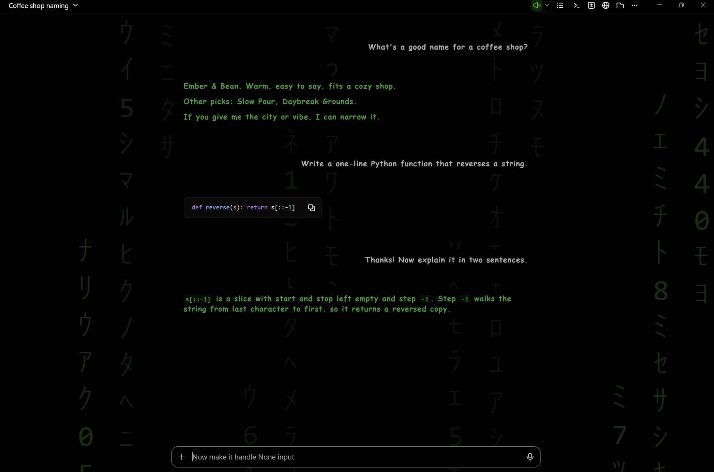

# Matrix theme for Claude Code desktop

A Matrix-style look for the Claude desktop app's Code tab: pure black ground, a slow falling code backdrop, soft green Claude messages, soft white user messages, neutral white and gray UI text, a bold script font, and optional sound cues.



The theme only changes how local Code tab sessions draw. It does not touch the regular chat tab or claude.ai.

## Install

At the prompt of a terminal session:

```
/plugin install matrix --marketplace Megabreadon/claude-matrix-theme
```

From a shell:

```
claude plugin install matrix --marketplace Megabreadon/claude-matrix-theme
```

In the desktop app, where `/plugin` does not run: click + next to the prompt box, then Plugins, Add marketplace with `Megabreadon/claude-matrix-theme`, then Add plugin.

## Settings

Open the plugin's settings in the app's plugin list.

| Setting | Choices | What it does |
| --- | --- | --- |
| Matrix theme | `on`, `off` | `off` switches the look back to the app's normal one and keeps the plugin installed. |
| Rain characters | `katakana`, `binary`, `hex`, `runes`, `math`, `symbols` | What falls in the background. |
| Sound pack | `matrix`, `minimal`, `off` | Sound cues for sending, finishing, asking and errors. |
| Sound: send, tool, done, ask, error, compact, click | `on`, `off` each | Mute single sounds and keep the rest. `tool` plays on every tool call, so it's the one most people turn off. |

Sound also needs the speaker icon in the session's title bar turned on. The theme makes its own tones and cannot play mp3 files.

## Turn it off or remove it

From lightest to full removal:

1. **Mute only:** set Sound pack to `off`.
2. **Back to the normal look, keep the plugin:** set Matrix theme to `off`.
3. **Disable the plugin:** `claude plugin disable matrix`, or turn it off in the app's plugin list.
4. **Remove it completely:** `claude plugin uninstall matrix`.

A new session after any of these draws the app's normal look.

## Tweak it

Colors and fonts live in `hooks/register.tsx`: `GREEN` is Claude's text, the `UserMessage` color is yours, and the `anchors` hold the surface and text grays.
